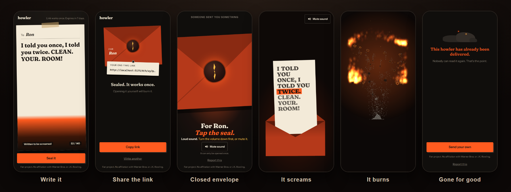
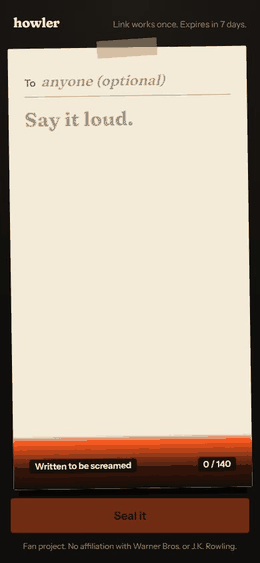
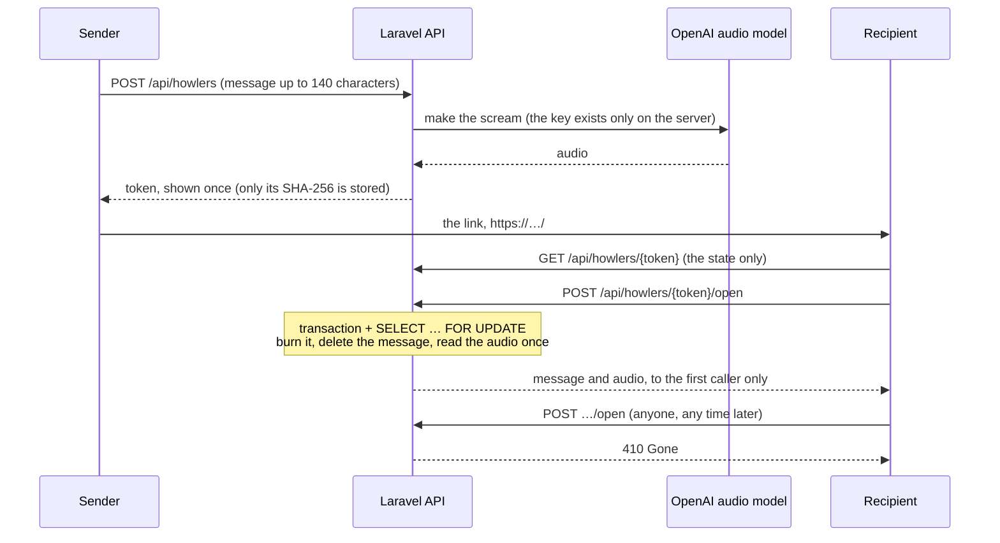
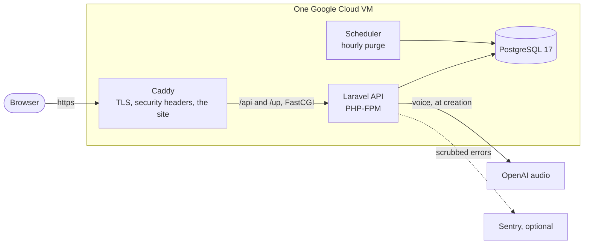

<div align="center">

# Howler

**Write it. Send the link. It screams once, then burns.**

[English](README.md) · [Português](README.pt-BR.md)

[](https://github.com/raabesmps/howler/actions/workflows/ci.yml)
[](https://github.com/raabesmps/howler/releases)
[](LICENSE)




</div>

Howler is a one-time message with a temper. You write up to 140 characters and get a link. Whoever opens it sees a closed envelope that rumbles, tears open and **screams the message in a hysterical, furious mother's voice**, shaking with every shout. Then it closes, burns from the centre outward and falls into powder. **The link works once.** Afterwards the message is gone from the server, and the link only says it was delivered.

**Try it:** <https://howler.aquifunciona.dev.br> (live, with the real voice). Start with the volume low: it is meant to be loud.

<p align="center"></p>

> Fan project. No affiliation with Warner Bros. or J.K. Rowling. The character is a tone, never an impersonation, and nothing here uses franchise names, art or sounds.

## How it works



## Engineering notes

The product is small; the interesting part is keeping its promises.

| Promise | How it is kept |
|---------|----------------|
| **A link opens exactly once**, even if many people open it at the same instant | Opening is a `POST` that runs in a transaction with `SELECT … FOR UPDATE`: the first caller burns the howler and gets the message, every other one gets `410`. A test starts 12 separate PHP processes against PostgreSQL and asserts that exactly one gets it (and fails if the lock is removed). Link previews and crawlers only send `GET`, so they cannot burn a howler |
| **The message is not kept** | The token is stored only as a SHA-256 hash, so a copy of the database holds no working link. Opening deletes the message in the same transaction (and the audio file right after), expiring does the same, and database `CHECK` constraints make it impossible to keep content on a burned or expired howler even through a bug. An hourly job expires overdue howlers and removes tombstones after 30 days. No IP or device is stored with a howler; the rate limiter keeps only a short-lived counter |
| **The voice is a fixed character**, nobody picks the tone | A pinned snapshot of OpenAI's `gpt-audio` (voice Coral) acts the line as a comedy-sketch actress; the model's transcript must match the text word for word, otherwise it retries once and falls back to the browser's own voice. The audio is made once, when the howler is created, and the device cleans it and levels its loudness: no echo, no hiss, no ear pain ([ADR-002](docs/decisions/ADR-002-voice-approach.md)) |
| **The envelope shakes with the voice** | The shaking is driven, every frame, by the real loudness of the audio (Web Audio analyser), so it hits on the stressed words and rests in the pauses |
| **The burn is smooth on any phone** | A canvas burn (a per-pixel burn front, flame sprites, falling fragments, a heap of powder) watches its own frame time and steps down through four quality levels until it keeps up |
| **Abuse and cost are bounded** | Per-IP limits (5 creations a minute and 40 a day, 30 reads a minute), a daily budget of server voices, a 140-character limit, requests over 8 KB refused at the edge |
| **A failure never loses a message** | No voice, no problem: the browser reads it. A dropped connection while opening leaves the envelope closed and retryable. Every error has its own plain words |
| **Error monitoring cannot leak the secrets** | Sentry is optional and scrubbed: the link token, the message, IPs, headers and breadcrumbs never leave the server or the page ([ADR-005](docs/decisions/ADR-005-error-monitoring.md)) |

## Architecture



One origin serves the site and the API, so there is no CORS, and the visitor's real address reaches PHP for the rate limits. Only Caddy publishes ports; the database and PHP-FPM stay inside the Docker network ([ADR-004](docs/decisions/ADR-004-hosting.md)).

## Tech stack

| Layer | Choices |
|-------|---------|
| Frontend | Vue 3, Vite, TypeScript, vue-router (hash history, so the token never leaves the browser in a request), Web Audio API, Canvas 2D |
| Backend | Laravel 13 on PHP 8.4, PostgreSQL 17 with ULID keys and `CHECK` constraints, the Laravel scheduler |
| Voice | OpenAI `gpt-audio` through the chat completions API, generated server-side |
| Infra | One Google Cloud VM, Docker Compose, Caddy (automatic HTTPS), images built in GitHub Actions and published to GHCR, manual deploys with an approval, over SSH, with a smoke test and automatic rollback |
| Quality | PHPUnit on a real PostgreSQL, Vitest, Playwright (with axe for accessibility), Pint, ESLint and `vue-tsc` |

## Run it locally

You need Docker (on Windows it runs inside WSL, see the guide) and Node.js 22.

```bash
git clone https://github.com/raabesmps/howler.git && cd howler
scripts/dev-up.sh                                       # PostgreSQL, ready to accept connections
docker compose run --rm backend php artisan migrate     # the tables
docker compose up -d backend                            # the API on http://localhost:8000
cd frontend && npm install && npm run dev               # the site on http://localhost:5173
```

For the real voice, put `OPENAI_API_KEY=…` in a git-ignored `.env.local` at the repository root (about 1.5 US cents per howler). Without it the browser's voice reads the message. To work on the screens without Docker: `VITE_API=mock npm run dev`. Everything is explained in the [development guide](docs/guides/DEVELOPMENT.md).

## Repository layout

```
frontend/   Vue 3 app: views, components, the audio engine, the canvas burn, the API client
backend/    Laravel API: actions, models, the voice service, the purge command, tests
e2e/        Playwright tests (journey, single use, failures, sound, accessibility)
docker/     Dockerfiles: the development PHP image and the production app and web images
deploy/     What runs on the server: compose file, Caddyfile, deploy, rollback, backup and setup scripts
docs/       project/ guides/ decisions/ api/ design/ assets/, each with a Portuguese mirror in pt-BR/
scripts/    Development helpers and the documentation checker
.github/    CI (frontend, backend, e2e, images, docs) and the production deploy workflow
```

## Quality

| Layer | Tool | Proves |
|-------|------|--------|
| Backend | PHPUnit on PostgreSQL | States and their database constraints, the four endpoints, rate limits, retention, the voice (OpenAI faked: any stray request fails the test), headers and CORS, the monitoring scrubber, the 12-process concurrency test |
| Frontend | Vitest | The API client and its errors, error wording, text timing, audio helpers, the burn's performance budget |
| End to end | Playwright, Chromium on a phone viewport | A real browser against the real stack: the journey, a second open from anywhere, connection failures, keyboard-only and reduced motion, the sound controls, axe checks on every screen |
| Delivery | GitHub Actions | `frontend`, `backend`, `e2e` and `images` on every pull request; the Dockerfiles must build before anything reaches `main` |

How to run each layer, what is deliberately not covered and the manual accessibility checklist are in the [testing guide](docs/guides/TESTING.md).

## Deployment

Merging to `main` only builds and tests. **A release is a button that needs an approval:** you run the `Deploy production` workflow, GitHub asks the owner to approve the `production` environment, and only then the two images are built from a commit with a green CI, published to the GitHub registry and deployed to the VM over SSH with a pinned host key. A database dump is taken first. `deploy.sh` migrates, starts the new version and checks `/up`, and **if it is not healthy within about a minute it puts the previous version back by itself**. Then a smoke test lives a howler's whole life against the real site (create, look, open, open again, the closed doors, an expiry and the purge); if it fails, the previous version comes back too. Rolling back by hand works from the server (`rollback.sh`) or by deploying an older tag from the workflow. A daily dump is kept for 7 days. All of it, with the VM setup, the secrets and the troubleshooting table, is in the [deployment runbook](docs/guides/DEPLOYMENT.md).

## Documentation

Everything is in English with a Portuguese tab. The [documentation index](docs/README.md) lists it all; the essentials:

| | |
|---|---|
| [Development guide](docs/guides/DEVELOPMENT.md) | Run the database, the API and the site on your machine |
| [Testing guide](docs/guides/TESTING.md) | The strategy, how to run each layer, coverage notes |
| [Deployment runbook](docs/guides/DEPLOYMENT.md) | VM, GitHub, deploy, rollback, monitoring, backups, secrets |
| [API](docs/api/README.md) · [OpenAPI](docs/api/openapi.yaml) | The four endpoints and the single-use behaviour |
| [Design](docs/design/tokens.md) | The visual direction, tokens and wireframes |
| [Plan](docs/project/PLAN.md) · [Status](docs/project/STATUS.md) | The master plan and where the project is now |

## Architecture decisions

| | Decision |
|---|----------|
| [ADR-001](docs/decisions/ADR-001-stack-and-layout.md) | Stack and repository layout |
| [ADR-002](docs/decisions/ADR-002-voice-approach.md) | The voice: model, tone, treatment, guards, fallback |
| [ADR-003](docs/decisions/ADR-003-data-model-and-retention.md) | Data model and retention: hashed tokens, deletion, tombstones |
| [ADR-004](docs/decisions/ADR-004-hosting.md) | Hosting: one VM with Docker Compose, and why not Netlify |
| [ADR-005](docs/decisions/ADR-005-error-monitoring.md) | Error monitoring and what may leave the server |

## Status

The project is built in checkpoints, one pull request each, merged without squash and tagged.

| | Checkpoint | |
|---|-----------|---|
| CP0 – CP1 | Repository and rules, visual direction and wireframes | done |
| CP2 – CP5 | The frontend-only prototype: audio lab (superseded by a fixed tone), envelope and burn, sound and voice, the full flow | done |
| CP6 – CP7 | Data model and the single-use API | done |
| CP8 | Frontend connected to the backend | done |
| CP9 | Tests, accessibility and CI | done |
| CP10 | Staging: images, deploy, rollback, monitoring | done |
| CP11 | Production and launch: manual deploy with approval, smoke test, license | done, **v1.0.0** |

Current details are in [docs/project/STATUS.md](docs/project/STATUS.md). Refining the layout is the next piece of work.

## License

[MIT](LICENSE). It covers the code and the original art of this repository. It grants nothing about any third-party franchise, which this project neither uses nor claims: see the fan-project notice at the top.
