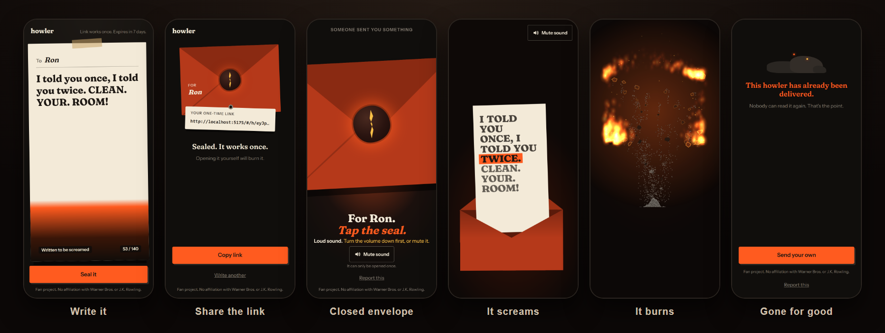
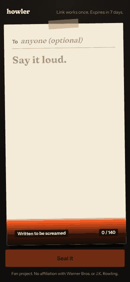
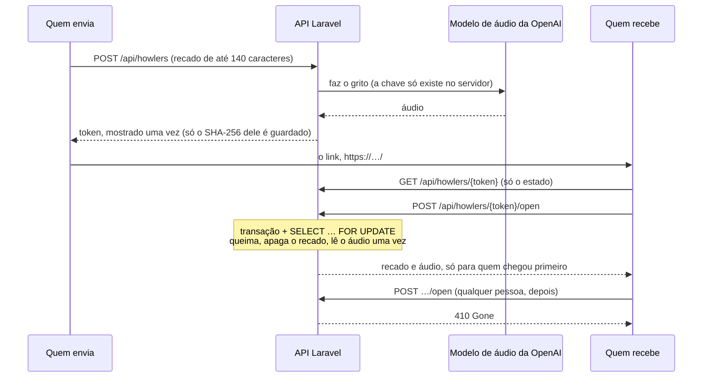
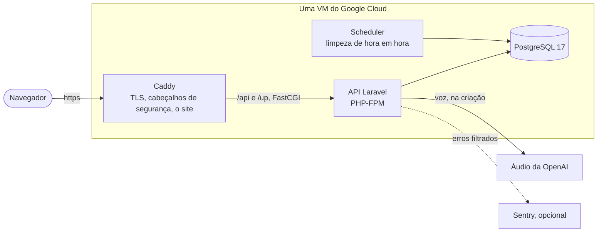

<div align="center">

# Howler

**Escreva. Mande o link. Ele grita uma vez e queima.**

[English](README.md) · [Português](README.pt-BR.md)

[](https://github.com/raabesmps/howler/actions/workflows/ci.yml)
[](https://github.com/raabesmps/howler/releases)
[](LICENSE)




</div>

O Howler é um recado de uso único, com mau humor. Você escreve até 140 caracteres e recebe um link. Quem abrir vê um envelope fechado que ronca, rasga e **grita o recado com a voz de uma mãe histérica e furiosa**, tremendo a cada berro. Depois ele fecha, queima do centro para fora e vira pó. **O link funciona uma vez.** Depois disso o recado não existe mais no servidor, e o link só diz que ele foi entregue.

**Experimente:** <https://howler.aquifunciona.dev.br> (no ar, com a voz de verdade). Comece com o volume baixo: ele foi feito para ser alto.

<p align="center"></p>

> Projeto de fã. Sem ligação com a Warner Bros. nem com J.K. Rowling. A personagem é um tom, nunca uma imitação, e nada aqui usa nomes, imagens ou sons da franquia.

## Como funciona



## Notas de engenharia

O produto é pequeno; a parte interessante é cumprir as promessas dele.

| Promessa | Como é cumprida |
|----------|-----------------|
| **Um link abre exatamente uma vez**, mesmo que várias pessoas o abram no mesmo instante | Abrir é um `POST` que roda numa transação com `SELECT … FOR UPDATE`: o primeiro queima o howler e recebe o recado, todos os outros recebem `410`. Um teste dispara 12 processos PHP separados contra o PostgreSQL e confere que exatamente um recebe (e ele falha se a trava for removida). Prévias de link e robôs só enviam `GET`, então não conseguem queimar um howler |
| **O recado não é guardado** | O token é guardado só como hash SHA-256, então uma cópia do banco não contém nenhum link que funcione. Abrir apaga o recado na mesma transação (e o arquivo de áudio logo depois), expirar faz o mesmo, e restrições `CHECK` do banco tornam impossível manter conteúdo num howler queimado ou expirado, mesmo com um bug. Uma tarefa de hora em hora expira os howlers vencidos e remove as marcas de túmulo depois de 30 dias. Nenhum IP ou aparelho é guardado com um howler; o limitador de pedidos guarda só um contador de vida curta |
| **A voz é uma personagem fixa**, ninguém escolhe o tom | Uma versão fixada do `gpt-audio` da OpenAI (voz Coral) interpreta a frase como uma atriz de esquete cômico; a transcrição do modelo precisa bater com o texto palavra por palavra, senão ele tenta uma vez mais e cai para a voz do próprio navegador. O áudio é feito uma vez, quando o howler é criado, e o aparelho o limpa e nivela o volume: sem eco, sem chiado, sem dor de ouvido ([ADR-002](docs/pt-BR/decisions/ADR-002-voice-approach.md)) |
| **O envelope treme com a voz** | O tremor é guiado, a cada quadro, pelo volume real do áudio (analisador do Web Audio), então bate nas palavras fortes e descansa nas pausas |
| **A queima é fluida em qualquer celular** | A queima em canvas (uma frente de fogo por pixel, sprites de chama, fragmentos caindo, um monte de pó) observa o próprio tempo de quadro e desce por quatro níveis de qualidade até acompanhar |
| **Abuso e custo têm limite** | Limites por IP (5 criações por minuto e 40 por dia, 30 leituras por minuto), um orçamento diário de vozes do servidor, limite de 140 caracteres, pedidos acima de 8 KB recusados na borda |
| **Uma falha nunca perde um recado** | Sem voz, sem problema: o navegador lê. Uma conexão que cai ao abrir deixa o envelope fechado e dá para tentar de novo. Cada erro tem as suas próprias palavras |
| **O monitoramento de erros não vaza os segredos** | O Sentry é opcional e filtrado: o token do link, o recado, IPs, cabeçalhos e breadcrumbs nunca saem do servidor nem da página ([ADR-005](docs/pt-BR/decisions/ADR-005-error-monitoring.md)) |

## Arquitetura



Uma origem só serve o site e a API, então não há CORS, e o endereço real do visitante chega ao PHP para os limites de pedidos. Só o Caddy publica portas; o banco e o PHP-FPM ficam dentro da rede do Docker ([ADR-004](docs/pt-BR/decisions/ADR-004-hosting.md)).

## Stack

| Camada | Escolhas |
|--------|----------|
| Frontend | Vue 3, Vite, TypeScript, vue-router (histórico por hash, então o token nunca sai do navegador num pedido), Web Audio API, Canvas 2D |
| Backend | Laravel 13 em PHP 8.4, PostgreSQL 17 com chaves ULID e restrições `CHECK`, o scheduler do Laravel |
| Voz | `gpt-audio` da OpenAI pela API de chat completions, gerada no servidor |
| Infra | Uma VM do Google Cloud, Docker Compose, Caddy (HTTPS automático), imagens construídas no GitHub Actions e publicadas no GHCR, deploys manuais com aprovação, por SSH, com teste de fumaça e rollback automático |
| Qualidade | PHPUnit num PostgreSQL de verdade, Vitest, Playwright (com axe para acessibilidade), Pint, ESLint e `vue-tsc` |

## Rodar localmente

Você precisa de Docker (no Windows ele roda dentro do WSL, veja o guia) e Node.js 22.

```bash
git clone https://github.com/raabesmps/howler.git && cd howler
scripts/dev-up.sh                                       # PostgreSQL, pronto para receber conexões
docker compose run --rm backend php artisan migrate     # as tabelas
docker compose up -d backend                            # a API em http://localhost:8000
cd frontend && npm install && npm run dev               # o site em http://localhost:5173
```

Para a voz de verdade, ponha `OPENAI_API_KEY=…` num `.env.local` (ignorado pelo git) na raiz do repositório (cerca de 1,5 centavo de dólar por howler). Sem ela, a voz do navegador lê o recado. Para mexer nas telas sem Docker: `VITE_API=mock npm run dev`. Tudo está explicado no [guia de desenvolvimento](docs/pt-BR/guides/DEVELOPMENT.md).

## Estrutura do repositório

```
frontend/   App Vue 3: telas, componentes, o motor de áudio, a queima em canvas, o cliente da API
backend/    API Laravel: ações, modelos, o serviço de voz, o comando de limpeza, testes
e2e/        Testes Playwright (jornada, uso único, falhas, som, acessibilidade)
docker/     Dockerfiles: a imagem PHP de desenvolvimento e as imagens de produção (app e web)
deploy/     O que roda no servidor: compose, Caddyfile, scripts de deploy, rollback, backup e preparo
docs/       project/ guides/ decisions/ api/ design/ assets/, cada um com o espelho em português em pt-BR/
scripts/    Ajudantes de desenvolvimento e o verificador da documentação
.github/    CI (frontend, backend, e2e, images, docs) e o workflow de deploy de produção
```

## Qualidade

| Camada | Ferramenta | Prova |
|--------|-----------|-------|
| Backend | PHPUnit no PostgreSQL | Estados e suas restrições no banco, os quatro endpoints, limites de pedidos, retenção, a voz (OpenAI simulada: qualquer pedido solto faz o teste falhar), cabeçalhos e CORS, o filtro do monitoramento, o teste de concorrência com 12 processos |
| Frontend | Vitest | O cliente da API e seus erros, o texto dos erros, o tempo do texto, funções de áudio, o orçamento de desempenho da queima |
| Ponta a ponta | Playwright, Chromium com tela de celular | Um navegador de verdade contra a stack de verdade: a jornada, uma segunda abertura de qualquer lugar, falhas de conexão, só teclado e movimento reduzido, os controles de som, verificações do axe em todas as telas |
| Entrega | GitHub Actions | `frontend`, `backend`, `e2e` e `images` em todo pull request; os Dockerfiles precisam construir antes de qualquer coisa chegar à `main` |

Como rodar cada camada, o que de propósito não é coberto e a lista manual de acessibilidade estão no [guia de testes](docs/pt-BR/guides/TESTING.md).

## Deploy

Um merge na `main` só constrói e testa. **Uma versão é um botão que exige aprovação:** você roda o workflow `Deploy production`, o GitHub pede à dona que aprove o ambiente `production`, e só então as duas imagens são construídas a partir de um commit com a CI verde, publicadas no registro do GitHub e enviadas à VM por SSH com a chave do servidor fixada. Antes, é feito um dump do banco. O `deploy.sh` migra, sobe a versão nova e confere o `/up`, e **se ela não ficar saudável em cerca de um minuto, ele recoloca a versão anterior sozinho**. Em seguida um teste de fumaça vive a vida inteira de um howler contra o site de verdade (criar, olhar, abrir, abrir de novo, as portas fechadas, uma expiração e a limpeza); se ele falhar, a versão anterior também volta. Voltar atrás à mão funciona pelo servidor (`rollback.sh`) ou reimplantando uma tag antiga pelo workflow. Um dump diário é guardado por 7 dias. Tudo isso, com o preparo da VM, os segredos e a tabela de problemas, está no [runbook de deploy](docs/pt-BR/guides/DEPLOYMENT.md).

## Documentação

Tudo está em inglês com uma aba em português. O [índice da documentação](docs/pt-BR/README.md) lista tudo; o essencial:

| | |
|---|---|
| [Guia de desenvolvimento](docs/pt-BR/guides/DEVELOPMENT.md) | Rodar o banco, a API e o site na sua máquina |
| [Guia de testes](docs/pt-BR/guides/TESTING.md) | A estratégia, como rodar cada camada, notas de cobertura |
| [Runbook de deploy](docs/pt-BR/guides/DEPLOYMENT.md) | VM, GitHub, deploy, rollback, monitoramento, backups, segredos |
| [API](docs/pt-BR/api/README.md) · [OpenAPI](docs/api/openapi.yaml) | Os quatro endpoints e o comportamento de uso único |
| [Design](docs/pt-BR/design/tokens.md) | A direção visual, os tokens e os wireframes |
| [Plano](docs/pt-BR/project/PLAN.md) · [Status](docs/pt-BR/project/STATUS.md) · [Changelog](CHANGELOG.pt-BR.md) | O plano mestre, onde o projeto está agora e o que cada versão mudou |

## Decisões de arquitetura

| | Decisão |
|---|---------|
| [ADR-001](docs/pt-BR/decisions/ADR-001-stack-and-layout.md) | Stack e estrutura do repositório |
| [ADR-002](docs/pt-BR/decisions/ADR-002-voice-approach.md) | A voz: modelo, tom, tratamento, travas, reserva |
| [ADR-003](docs/pt-BR/decisions/ADR-003-data-model-and-retention.md) | Modelo de dados e retenção: tokens com hash, apagamento, marcas de túmulo |
| [ADR-004](docs/pt-BR/decisions/ADR-004-hosting.md) | Hospedagem: uma VM com Docker Compose, e por que não o Netlify |
| [ADR-005](docs/pt-BR/decisions/ADR-005-error-monitoring.md) | Monitoramento de erros e o que pode sair do servidor |

## Status

O projeto é construído em checkpoints, um pull request cada, mergeado sem squash e com tag.

| | Checkpoint | |
|---|-----------|---|
| CP0 – CP1 | Repositório e regras, direção visual e wireframes | feito |
| CP2 – CP5 | O protótipo só de frontend: laboratório de áudio (substituído por um tom fixo), envelope e queima, som e voz, o fluxo completo | feito |
| CP6 – CP7 | Modelo de dados e a API de uso único | feito |
| CP8 | Frontend ligado ao backend | feito |
| CP9 | Testes, acessibilidade e CI | feito |
| CP10 | Staging: imagens, deploy, rollback, monitoramento | feito |
| CP11 | Produção e lançamento: deploy manual com aprovação, teste de fumaça, licença | feito, **v1.0.0** |

Os detalhes atuais estão em [docs/pt-BR/project/STATUS.md](docs/pt-BR/project/STATUS.md), e cada versão está no [changelog](CHANGELOG.pt-BR.md) (a história da v1.0.0, com os seus limites conhecidos, está nas suas [notas da versão](docs/pt-BR/project/releases/v1.0.0.md)). O refinamento do layout é o próximo trabalho.

## Licença

[MIT](LICENSE). Ela cobre o código e a arte original deste repositório. Ela não concede nada sobre nenhuma franquia de terceiros, que este projeto nem usa nem reivindica: veja o aviso de projeto de fã no topo.
